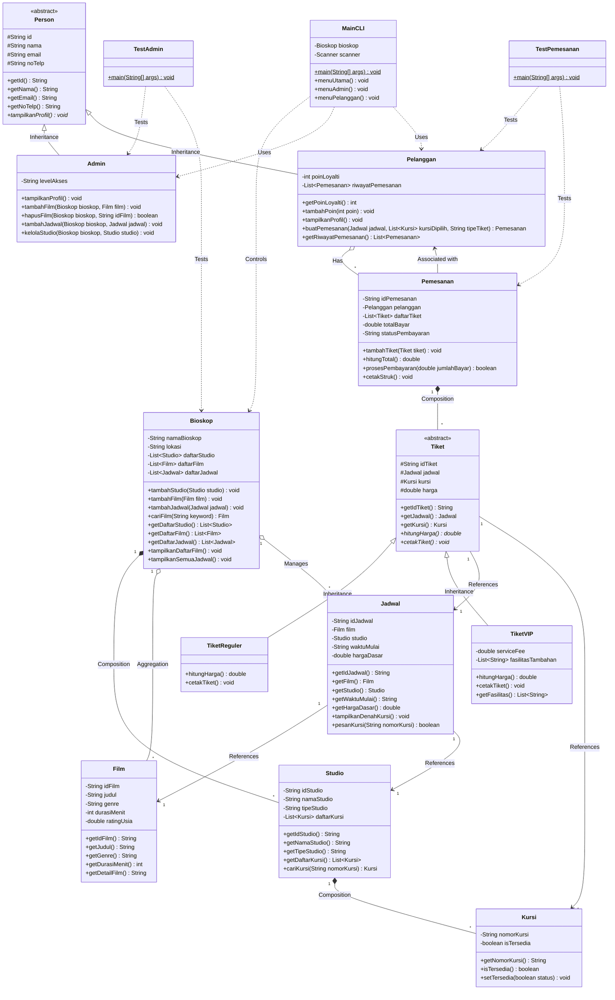

# 🍿 Cinema XXI - Sistem Pemesanan & Manajemen Bioskop (OOP Java)

Aplikasi Desktop sistem bioskop modern berbasis **JavaFX**, **FXML**, dan **Apache Maven** untuk mata kuliah Object-Oriented Programming (OOP).

---

## 🌟 Fitur Utama

### 🎬 1. Alur Pelanggan (Customer Booking Experience)
- **Katalog Film Sedang Tayang**: Tampilan kartu film modern lengkap dengan poster box, judul, genre, durasi, dan badge batas usia (misal `13+`).
- **Jadwal & Studio Chips**: Jadwal tayang dikelompokkan berdasarkan studio dengan tombol chip waktu dan harga tiket yang interaktif.
- **Pencarian Film Real-time**: Fitur pencarian cepat berdasarkan judul film atau genre.
- **Denah Kursi Studio Interaktif**:
  - Representasi lengkung visual layar bioskop.
  - Matriks kursi dinamis (`Studio.getJumlahBaris()`, `Studio.getKursiPerBaris()`) dengan lorong jalan.
  - Indikator visual real-time: **Tersedia (Emerald)**, **Terpilih (Cinema Gold)**, dan **Sudah Terisi (Disabled Muted)**.
- **Opsi Tipe Tiket**:
  - **Reguler**: Sesuai harga dasar studio/jadwal.
  - **VIP**: Tambahan fasilitas kursi *recliner*, snack, dan minuman (+Rp 25.000).
- **E-Tiket & Struk Transaksi Eksklusif**: Tampilan struk bergaya *boarding pass* lengkap dengan kode booking (`BOOK-xxxx`), detail pemesanan, dan mock barcode.

### ⚙️ 2. Panel Pengelola Bioskop (Admin Mode)
- **Ringkasan Metrik / KPI**: Kartu statistik total omset pendapatan, total transaksi pemesanan tiket, total film aktif, dan jumlah studio.
- **Manajemen Film**:
  - Tabel daftar seluruh film yang terdaftar.
  - Formulir pendaftaran film baru dengan validasi otomatis (judul, genre, durasi > 0, rating usia).
  - Aksi hapus film beserta jadwal terkait dengan dialog konfirmasi.
- **Manajemen Jadwal Tayang**:
  - Formulir pembukaan jadwal baru dengan relasi objek Film, Studio, DatePicker tanggal, ComboBox jam tayang, dan harga tiket.
  - Tabel jadwal tayang aktif beserta indikator kapasitas kursi yang sudah laku terjual.
- **Rekapitulasi Transaksi**:
  - Tabel riwayat seluruh pemesanan tiket.
  - Pencarian transaksi berdasarkan kode booking, nama pemesan, atau judul film.

---

## 🏛️ Penerapan Konsep OOP

1. **Inheritance (Pewarisan)**:
   - `Person` diturunkan menjadi `Pelanggan` dan `Admin`.
   - `Tiket` (abstract) diturunkan menjadi `TiketReguler` dan `TiketVIP`.
2. **Polymorphism (Polimorfisme)**:
   - Override metode `hitungHarga()` dan `getJenisTiket()` pada `TiketReguler` dan `TiketVIP`.
   - Overloading metode `tambahKursi(String kodeKursi, String jenis)` dan `tambahKursi(Kursi kursi, String jenis)`.
3. **Encapsulation (Enkapsulasi)**:
   - Penerapan *access modifier* `private` pada data atribut.
   - Validasi ketat pada setter (misal: judul film tidak boleh kosong, durasi > 0, kapasitas studio 1-26 baris).
4. **Abstraction & Aggregation**:
   - `Bioskop` sebagai *aggregate root* yang mengelola koleksi `Film`, `Studio`, `Jadwal`, dan `Pemesanan`.
   - Pemisahan arsitektur **MVC (Model-View-Controller)** yang bersih antara UI JavaFX/FXML dan model bisnis.

---

## 🚀 Cara Menjalankan Aplikasi

### Persyaratan:
- JDK 17 atau lebih baru
- Apache Maven 3.8+

### 1. Menjalankan Aplikasi GUI (JavaFX):
Gunakan perintah Maven berikut di terminal:
```bash
mvn javafx:run
```

### 2. Menjalankan Versi CLI (Opsional):
Jika ingin menjalankan antarmuka teks lama:
```bash
mvn compile exec:java -Dexec.mainClass="app.MainCLI"
```

### 3. Kompilasi & Pengujian:
```bash
mvn clean test
```
---
## Class Diagram


---
## 📁 Struktur Direktori Proyek

```
oop-project-bioskop/
├── pom.xml
├── README.md
└── src/
    ├── main/
    │   ├── java/
    │   │   ├── app/
    │   │   │   ├── App.java              # JavaFX Application Setup
    │   │   │   ├── AppContext.java       # Shared State / Singleton Bioskop & Admin
    │   │   │   ├── MainApp.java          # Launcher class
    │   │   │   └── MainCLI.java          # CLI interface lama
    │   │   ├── controller/
    │   │   │   ├── AdminController.java  # Controller Panel Admin & Rekap Transaksi
    │   │   │   ├── CustomerController.java # Controller Katalog, Denah Kursi, E-Tiket
    │   │   │   └── MainController.java   # Controller Navigasi Utama & Switcher View
    │   │   └── model/
    │   │       ├── bioskop/              # Bioskop, Film, Jadwal, Kursi, Studio
    │   │       ├── tiket/                # Pemesanan, Tiket, TiketReguler, TiketVIP
    │   │       └── user/                 # Admin, Pelanggan, Person
    │   └── resources/
    │       ├── css/
    │       │   └── style.css             # Tema modern gelap Cinema XXI
    │       └── fxml/
    │           ├── main-view.fxml        # Shell Navigasi Header & Kontainer Dinamis
    │           ├── admin/
    │           │   └── admin-view.fxml   # Tampilan Tab Admin
    │           └── customer/
    │               └── customer-view.fxml # Tampilan Katalog, Denah Kursi, E-Tiket
    └── test/
        └── java/
            └── app/                      # TestAdmin & TestPemesanan
```
